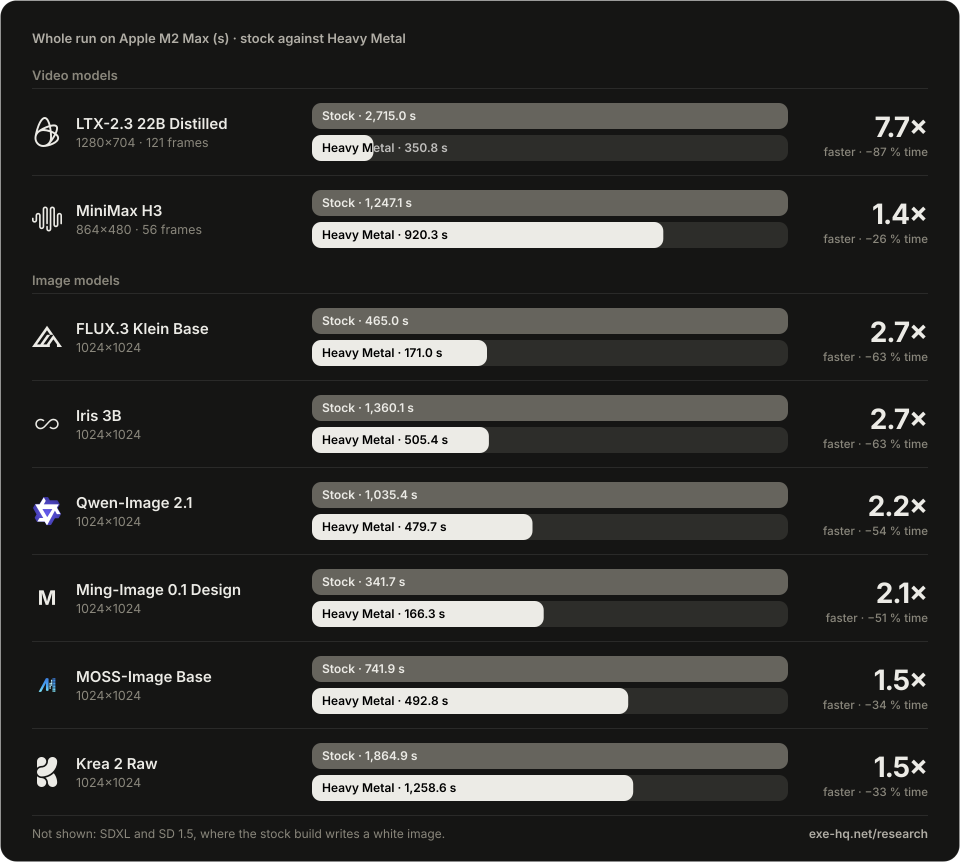

<p align="center">
  <a href="https://exe-hq.net">
  <picture>
    <source media="(prefers-color-scheme: dark)" srcset="docs/site/hero-dark.svg">
    <source media="(prefers-color-scheme: light)" srcset="docs/site/hero-light.svg">
    
  </picture>
  </a>
</p>

<h1 align="center">Exe Heavy Metal</h1>

<p align="center">
  Part of <a href="https://github.com/exe-ai-productions/exe-ai"><b>Exe AI</b></a>
  &nbsp;·&nbsp;
  <a href="https://exe-hq.net">exe-hq.net</a>
</p>

<p align="center"><b>Custom Metal kernels for ggml. Image and video generation with stable-diffusion.cpp, up to 7.7× faster on an M2 Max.</b></p>

<p align="center">
  Exe Heavy Metal is a fork of ggml's Metal backend. It adds kernels of its own for the work that image and video models
  spend their time on: convolutions, attention, normalization, rotary embeddings and memory copies.
  stable-diffusion.cpp runs on top unmodified, with the same command line and the same model files. Every kernel lives in the ggml fork.
</p>

<p align="center">
  <a href="#license"></a>
  
</p>

<p align="center">
  <a href="#exe-ai-from-model-to-image"><b>Get it in Exe AI</b></a>
  &nbsp;·&nbsp;
  <a href="#results">Results</a>
  &nbsp;·&nbsp;
  <a href="#research">Research</a>
  &nbsp;·&nbsp;
  <a href="#whats-inside">What's inside</a>
  &nbsp;·&nbsp;
  <a href="#build">Build</a>
  &nbsp;·&nbsp;
  <a href="#credits">Credits</a>
</p>

<p align="center">
  <a href="https://exe-hq.net/research/"></a>
</p>

## At a glance

- **7.7× on a whole video.** LTX-2.3, 1280×704, 121 frames with audio: 2,715.0 s with stock stable-diffusion.cpp, 350.8 s with Heavy Metal.
- **111× in the video decoder.** Decoding alone, in the same run: 2,278.0 s → 20.6 s.
- **2.2× median** over 19 whole runs of 10 image and video models. All 19 together: 3 h 32 min → 1 h 38 min.
- **No change to stable-diffusion.cpp.** Every kernel lives in ggml. Most of them can be switched off at run time.
- **Checked op by op.** ggml's `test-backend-ops` passes 17,940 of 17,940 cases on Metal against the CPU reference.
- **Ships in Exe AI.** On a Mac with an M1 or M2 chip, Heavy Metal is a single switch in [Exe AI](#exe-ai-from-model-to-image), with nothing to build.

## Results

Whole runs on one Apple M2 Max (38-core GPU, 64 GB unified memory, macOS 26.5.2), from process start to the written file, model loading included. Stock is the official build of stable-diffusion.cpp `master-1000-95ff762`. Heavy Metal is the same stable-diffusion.cpp source on the forked ggml. Both ran the same command: seed 42, one prompt, `--flash-attn on`, plus `--conv-direct auto,vae=on` for images and `--params-backend te=disk` for video. One run per row, alone on the GPU.

| Model | Size | Stock | Heavy Metal | Speedup | PSNR |
|---|---|---|---|---|---|
| LTX-2.3 22B Distilled, video, Q8_0, 4 steps | 1280×704, 121 frames | 2,715.0 s | 350.8 s | 7.7× | 32.95 dB |
| MiniMax H3, video, Q8_0, 20 steps | 864×480, 56 frames | 1,247.1 s | 920.3 s | 1.4× | 38.00 dB |
| Qwen-Image 2.1, F16, 30 steps | 1024×1024 | 1,035.4 s | 479.7 s | 2.2× | 59.13 dB |
| Krea 2 Raw, F16, 52 steps | 1024×1024 | 1,864.9 s | 1,258.6 s | 1.5× | 65.70 dB |
| FLUX.3 Klein Base, Q8_0, 20 steps | 1024×1024 | 465.0 s | 171.0 s | 2.7× | 58.25 dB |
| Iris 3B, F16, 100 steps | 1024×1024 | 1,360.1 s | 505.4 s | 2.7× | 58.35 dB |
| Ming-Image 0.1 Design, F16, 12 steps | 1024×1024 | 341.7 s | 166.3 s | 2.1× | 43.27 dB |
| MOSS-Image Base, F16, 50 steps | 1024×1024 | 741.9 s | 492.8 s | 1.5× | 44.32 dB |
| SDXL (CyberRealistic XL), F16, 20 steps | 1024×1024 | 112.5 s | 37.8 s | 3.0× | stock image is white |
| SD 1.5 (Realistic Vision 6), F16, 20 steps | 512×512 | 28.5 s | 7.0 s | 4.1× | stock image is white |

- **PSNR** compares the Heavy Metal output with the stock output, averaged over all frames. Images land at 43.27–65.94 dB. Video differs more: 32.95–39.64 dB. For comparison, two stock runs that differ only in the automatic flash-attention choice are 42.79 dB apart (9-frame test).
- **SDXL and SD 1.5.** In stock ggml, GROUP_NORM normalizes only the first image of a batch, so with batched CFG the stock build writes a white image. The stock time is for that white image. The Heavy Metal image is correct. On stock, `--batched-cfg off` avoids the white image.
- **Builds.** Each row names the fork build it ran on: ggml `34e0dc1c` for LTX-2.3, MiniMax H3, Qwen-Image 2.1 and Krea 2 Raw; `87d6c0aa` for Iris 3B, Ming-Image and MOSS-Image; `de043708` for FLUX.3 Klein Base; `b100353a` for SDXL and SD 1.5.
- **Peak memory** of the two video runs with Heavy Metal: 42.35 GB for MiniMax H3, 31.67 GB for LTX-2.3.

<details>
<summary>Smaller frames</summary>

| Model | Size | Stock | Heavy Metal | Speedup | PSNR |
|---|---|---|---|---|---|
| LTX-2.3 22B Distilled, video | 384×384, 121 frames | 514.0 s | 127.1 s | 4.0× | 35.71 dB |
| MiniMax H3, video | 384×384, 56 frames | 544.3 s | 408.9 s | 1.3× | 39.64 dB |
| Qwen-Image 2.1 | 512×512 | 288.0 s | 159.5 s | 1.8× | 57.07 dB |
| Krea 2 Raw | 512×512 | 489.1 s | 339.2 s | 1.4× | 65.94 dB |
| FLUX.3 Klein Base | 512×512 | 115.5 s | 43.7 s | 2.6× | 58.02 dB |
| Iris 3B | 512×512 | 427.2 s | 150.8 s | 2.8× | 44.10 dB |
| Ming-Image 0.1 Design | 512×512 | 167.2 s | 121.6 s | 1.4× | 49.06 dB |
| MOSS-Image Base | 512×512 | 191.6 s | 113.2 s | 1.7× | 56.93 dB |
| SDXL (CyberRealistic XL) | 512×512 | 41.7 s | 11.7 s | 3.6× | stock image is white |

</details>

## Research

The kernels and the method behind them are written up in seven technical reports at [Exe AI Labs](https://exe-hq.net/research/). The whole-run figures above are from report 6.

1. [Fast 3D Convolutions for Local Video Generation on Apple Silicon](https://exe-hq.net/research/reports/technical-report-1.pdf)
2. [Memory and Speed Together: Optimising Local Video Generation on Apple Silicon](https://exe-hq.net/research/reports/technical-report-2.pdf)
3. [Beyond the Convolution: Attention, Small Ops and Image Models on Apple Silicon](https://exe-hq.net/research/reports/technical-report-3.pdf)
4. [Image Models at Full Load: Normalisation, Rotary Embeddings and Attention Blocks on Apple Silicon](https://exe-hq.net/research/reports/technical-report-4.pdf)
5. [Video Models at Full Load: Unpacked Weights, Fused Epilogues and Fewer Small Ops on Apple Silicon](https://exe-hq.net/research/reports/technical-report-5.pdf)
6. [Before and After: Every Model, Original Against Exe AI on Apple Silicon](https://exe-hq.net/research/reports/technical-report-6.pdf)
7. [Exe AI on Apple Silicon: Video 7.7× Faster Than the Original, Ahead of MLX on a Newer Chip](https://exe-hq.net/research/reports/technical-report-7.pdf)

## Exe AI: from model to image

[Exe AI](https://exe-hq.net) is a local-first AI workspace for macOS and Windows. It generates images and video with stable-diffusion.cpp and ships Heavy Metal as its Metal engine. Switch Heavy Metal on once; there is no command line.

1. **Pick a model.** The catalog shows one card per model, with the maker's icon and the full download size.
2. **Download it with one click.** Every part of the model lands where it belongs. An interrupted download resumes where it stopped.
3. **Start with its defaults.** Each model opens with its own preset values.
4. **Generate.** Write a prompt in the Images area, or ask for a picture in any chat. Results stay in the gallery.
5. **Keep the model warm.** Exe AI drives `sd-server`, which keeps the model loaded between jobs: with Heavy Metal, a second LTX-2.3 job at 384×384 took 41.4 s, against 124.1 s for the first, which loads the model.

<!-- SCREENSHOT PLACEHOLDER: docs/screens/exe-ai-images.png (the Images area with Heavy Metal on, to be supplied)
<p align="center">
  
</p>
-->

<p align="center">
  <a href="https://exe-hq.net"><picture><source media="(prefers-color-scheme: dark)" srcset="docs/site/download-macos-dark.svg"><source media="(prefers-color-scheme: light)" srcset="docs/site/download-macos-light.svg"></picture></a>
</p>

## What's inside

Everything below sits in ggml's Metal backend and was written for this fork, unless a source is named. Each line gives a measured gain; where two changes were measured together, the line says so.

- **`heavy_metal_exe_winograd`**: 3×3 convolutions, 3D and 2D, using Winograd F(4×4, 3×3) with float intermediates, including stride 2. LTX-2.3 video decode at 1280×704: 30.19 s, against 55.67 s on ccv's kernel. An SDXL stride-2 downsampler: 43.2 → 2.05 ms.
- **`heavy_metal_exe_gemm`**: convolution as an implicit matrix product on ggml's own memory layout, half operands, float accumulation. It handles the shapes Winograd doesn't cover. LTX-2.3 decode at 384×384: 9.39 s against 10.98 s on ccv's kernel, with a VAE buffer of 2,737 MB instead of 4,381 MB.
- **ccv's `Conv3DKernel`**: the 3D convolution generator of ccv, vendored and selectable. On the 42 convolutions of the LTX-2.3 video decoder it runs 56× faster than ggml's stock kernel.
- **Metal FlashAttention**: a forward kernel built with the Metal FlashAttention generator that ships in ccv, with scores and softmax in f32, for head sizes 64, 128 and 512. One LTX-2.3 attention call (32 heads of 128, 14,080 tokens): 491.25 → 320.26 ms. The SDXL VAE attention (one head of 512): 366 → 96.4 ms.
- **`heavy_metal_exe_group_norm`**: GROUP_NORM over every image of a batch, up to 1,024 threads per group, one read for both statistics. 1024×1024×128: 140.7 → 5.16 ms.
- **`heavy_metal_exe_rope_apply`**: rotary embeddings from a precomputed table, an op ggml's stock Metal backend does not support. Krea 2 at 1024×1024: 28.05 → 26.51 s per step.
- **`heavy_metal_exe_concat`**: a flat 16-byte copy for contiguous CONCAT. An LTX VAE shape: 4.02 → 1.60 ms.
- **Fast copies**: row and tile kernels for same-shape copies, and per-thread kernels for short permuted dimensions. Same-shape copies: 35–60 GB/s → 360–490 GB/s. The permute of stable-diffusion.cpp's rotary table: 28.62 → 2.42 ms.
- **CONV_2D on the convolution kernels**: a 2D convolution runs as a 3D one of depth 1, and binary ops share a threadgroup across short rows. Together, Qwen-Image 2.1 Turbo at 1024×1024: decode 11.40 → 3.75 s, step 13.80 → 7.92 s.
- **Full threadgroups for small ops**: unary ops, IM2COL and CONV_TRANSPOSE_1D. LTX-2.3 audio decode at 384×384, together with the fast copies: 7.55 → 2.72 s.
- **Matrix products with an unaligned K**: bounds checks only in the last K block. Iris 3B's MLP product: 72.3 → 14.6 ms. Iris 3B at 1024×1024: 8.89 → 5.01 s per step.
- **Q8_0 weights unpacked to F16** for products with at least 1,024 rows. 4096×14080×4096: 44.9 → 40.9 ms. One LTX-2.3 step at 1280×704: 57.8 → 53.9 s.
- **Fused epilogues**: SCALE and the bias ADD inside the matrix-product kernel, and CONT with CPY to F16 in one copy. A Q8_0 product of 4096×14080×4096 with its bias: 41.27 ms with a separate ADD, 40.35 ms fused.
- **Command-buffer split**: long graphs go to the GPU in several command buffers, so no single buffer runs into the WindowServer watchdog of macOS. Longest buffer of an LTX-2.3 step at 1280×704: 74.9 s → 1.28 s, pixels identical, no time lost.
- **Op profiler**: `GGML_METAL_OP_PROFILE=1` prints the GPU time of every op, with GFLOP/s and GB/s.

## Requirements

- **A Mac with Apple Silicon.** Measured on an M2 Max (38-core GPU, 64 GB). Metal FlashAttention runs on the Apple7 and Apple8 GPU families (M1, M2); other chips keep ggml's attention kernel.
- **macOS.** Measured on macOS 26.5.2.
- **Weights in F16 or Q8_0.** BF16 is not supported: the M2 Max has no native BF16 arithmetic.
- **Build tools.** CMake, Ninja and Apple clang.

## Build

```sh
git clone --recursive https://github.com/exe-ai-productions/exe-heavy-metal
cd exe-heavy-metal
cmake -S . -B build -G Ninja \
  -DCMAKE_BUILD_TYPE=Release \
  -DSD_METAL=ON \
  -DSD_BUILD_SHARED_LIBS=ON \
  -DCMAKE_C_COMPILER=/usr/bin/clang \
  -DCMAKE_CXX_COMPILER=/usr/bin/clang++
cmake --build build --config Release -j 8
```

The build writes `build/bin/sd-cli`, `build/bin/sd-server` and `build/bin/libstable-diffusion.dylib`. The Metal library is embedded in the build. Add `-DGGML_BUILD_TESTS=ON` to build ggml's `test-backend-ops`; `test-backend-ops test -b MTL0` checks every Metal op against the CPU.

For images, pass `--conv-direct auto,vae=on`. It sends the VAE's 2D convolutions to `heavy_metal_exe_winograd`; without it, stable-diffusion.cpp uses IM2COL and a matrix product.

<details>
<summary>Run-time switches</summary>

Most switches restore the stock path for that op, so a single build can measure both.

| Variable | Effect |
|---|---|
| `GGML_METAL_CONV3D_KERNEL=heavy_metal_exe_gemm` or `ccv` | a convolution kernel other than the default `heavy_metal_exe_winograd` |
| `GGML_METAL_CONV3D_CCV=0` | ggml's stock 3D convolution |
| `GGML_METAL_CONV2D_FAST=0` | ggml's stock 2D convolution |
| `GGML_METAL_FA_MFA=0` | ggml's attention kernel |
| `GGML_METAL_GROUP_NORM_KERNEL=ggml` | ggml's GROUP_NORM |
| `GGML_METAL_ROPE_APPLY=0` | the stock fallback for rotary embeddings |
| `GGML_METAL_CONCAT_KERNEL=ggml` | ggml's CONCAT |
| `GGML_METAL_CPY_FAST=0` | ggml's copy kernel |
| `GGML_METAL_IM2COL_FLAT=0` | ggml's IM2COL |
| `GGML_METAL_MM_Q8_UNPACK=0` | Q8_0 products without unpacking |
| `GGML_METAL_FUSION_DISABLE=1` | no fusions |
| `GGML_METAL_CB_SPLIT=off` | stock command buffers |

</details>

## Credits

Heavy Metal builds on the work of others.

- **[ggml](https://github.com/ggml-org/ggml)**, the tensor library this fork extends. MIT License, copyright 2023–2026 The ggml authors. stable-diffusion.cpp pins its ggml through [leejet/ggml](https://github.com/leejet/ggml), the base of this fork.
- **[stable-diffusion.cpp](https://github.com/leejet/stable-diffusion.cpp)** by leejet, which runs on top unmodified. MIT License, copyright 2023 leejet.
- **[ccv](https://github.com/liuliu/ccv)** by Liu Liu: the `Conv3DKernel` sources, vendored at revision `3564f9f` (11 files byte-identical, 4 with one changed `#include` line), and the Metal FlashAttention generator behind the attention kernel. BSD 3-Clause License, copyright 2010 Liu Liu. The adapter derived from ccv keeps that notice.
- **Metal FlashAttention** by Philip Turner, whose generator ccv ships. The generated attention kernel carries its MIT License, copyright 2024 Philip Turner, next to ccv's.
- **metal-cpp** by Apple, the C++ interface to Metal used by the ccv sources. Apache License 2.0.

## License

The kernels written for Heavy Metal are released under the MIT License, copyright 2026 Exe AI Productions; see [`ggml/LICENSE-HEAVY-METAL`](ggml/LICENSE-HEAVY-METAL). stable-diffusion.cpp and ggml keep their own MIT licenses ([`LICENSE`](LICENSE), [`ggml/LICENSE`](ggml/LICENSE)), and vendored code keeps its own license, as listed under [Credits](#credits). The README of stable-diffusion.cpp itself is kept as [`STABLE-DIFFUSION-CPP.md`](STABLE-DIFFUSION-CPP.md).
